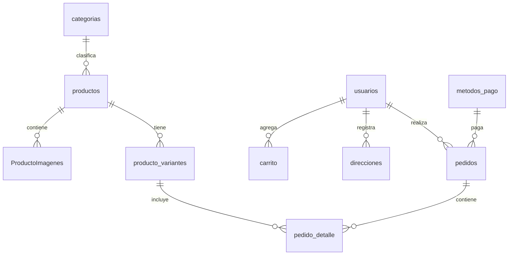

# 🗄️ Base de Datos SQL Server - Tienda de Ropa (NOVA Studio)

Este directorio contiene los scripts SQL completos y las instrucciones necesarias para inicializar la base de datos **TiendaRopa** en cualquier entorno local tras clonar el repositorio.

---

## 📁 Archivos Disponibles

- **`init.sql`** (o `TiendaRopa.sql` en la raíz): Script idempotente completo en codificación **UTF-8** que:
  1. Crea la base de datos `TiendaRopa`.
  2. Crea las 11 tablas con sus claves primarias, foráneas, restricciones y valores por defecto.
  3. Añade índices de rendimiento para optimizar búsquedas.
  4. Carga las categorías de moda.
  5. Crea los usuarios por defecto (`admin` y `cliente`).
  6. Registra los métodos de pago (Yape, Plin, Tarjeta, Transferencia, Efectivo).
  7. Inserta el catálogo de prendas boutique con fotos reales en alta definición.
  8. Genera variantes con tallas, colores y stock.
  9. Registra pedidos históricos para que el **Panel de Administración (`/dashboard`)** muestre gráficos y métricas de ventas reales de inmediato.

---

## 🚀 Cómo Ejecutar el Script

Puedes ejecutar el script utilizando cualquiera de las siguientes herramientas:

### Opción 1: SQL Server Management Studio (SSMS) o Azure Data Studio
1. Abre **SSMS** o **Azure Data Studio** y conéctate a tu instancia de SQL Server (por ejemplo: `localhost` o `.\SQLEXPRESS`).
2. Abre el archivo `init.sql` (o `TiendaRopa.sql`).
3. Presiona **F5** o haz clic en **Execute** / **Ejecutar**.
4. Verifica en el panel inferior que todas las tablas y registros se hayan creado exitosamente.

### Opción 2: Terminal / PowerShell con `sqlcmd`
Si tienes instalado `sqlcmd` en tu sistema:

```powershell
# Usando Autenticación de Windows
sqlcmd -S localhost -E -i database/init.sql

# O especificando usuario 'sa' y contraseña
sqlcmd -S localhost -U sa -P TuPassword123 -i database/init.sql
```

### Opción 3: Visual Studio Code
1. Instala la extensión oficial **SQL Server (mssql)** en VS Code.
2. Abre el archivo `database/init.sql`.
3. Presiona `Ctrl + Shift + P` -> selecciona **MS SQL: Connect** y elige tu servidor local.
4. Presiona `Ctrl + Shift + E` para ejecutar todo el script.

---

## 🔑 Credenciales de Acceso Creadas

| Usuario / Correo | Contraseña | Rol Asignado | Vista Predeterminada |
|---|---|---|---|
| `admin` o `admin@nova.com` | `1234` | `administrador` | **Panel Admin & Métricas** (`/dashboard`) |
| `cliente` o `cliente@nova.com` | `1234` | `cliente` | **Tienda Boutique** (`/tienda`) |

> [!NOTE]
> Las contraseñas se almacenan tanto en formato plano para desarrollo como en hash seguro **Bcrypt** (`$2b$10$...`) para máxima compatibilidad con las validaciones del backend.

---

## ⚙️ Configuración del Backend (`backend-node/.env`)

Para conectar el backend de Node.js a tu base de datos recién creada:

1. Ve a la carpeta `backend-node/`.
2. Si no existe el archivo `.env`, copia `.env.example`:
   ```powershell
   copy .env.example .env
   ```
3. Configura tus parámetros de conexión:

```ini
PORT=8082
JWT_SECRET=clave-secreta-local-ventaropa

# Autenticación de Windows (Recomendada si usas SSMS local)
DB_WINDOWS_AUTH=true
DB_SERVER=localhost
DB_NAME=TiendaRopa
DB_TRUST_SERVER_CERTIFICATE=true
DB_CONNECTION_STRING=Driver={ODBC Driver 18 for SQL Server};Server=localhost;Database=TiendaRopa;Trusted_Connection=Yes;TrustServerCertificate=Yes
```

> [!TIP]
> Si tienes instalado el controlador ODBC 17 en vez del 18, cambia `ODBC Driver 18 for SQL Server` por `ODBC Driver 17 for SQL Server` o `SQL Server`.

---

## 📊 Estructura de Tablas



- **`dbo.categorias`**: Categorías de vestimenta y accesorios.
- **`dbo.productos`**: Prendas del catálogo boutique con título, descripción, género y foto principal.
- **`dbo.producto_variantes`**: Tallas, colores, stock unitario y SKU.
- **`dbo.ProductoImagenes`**: Galería de fotos por producto y variante.
- **`dbo.usuarios`**: Cuentas de administradores y clientes.
- **`dbo.metodos_pago`**: Opciones de pasarela y pago presencial.
- **`dbo.pedidos`**: Cabecera de órdenes de compra con estado, totales y fecha.
- **`dbo.pedido_detalle`**: Líneas de cada pedido asociadas a sus variantes.
- **`dbo.direcciones`**: Direcciones de entrega guardadas.
- **`dbo.carrito`**: Carrito de compras persistente.
- **`dbo.tokens_recuperacion`**: Tokens de restablecimiento de contraseña.
